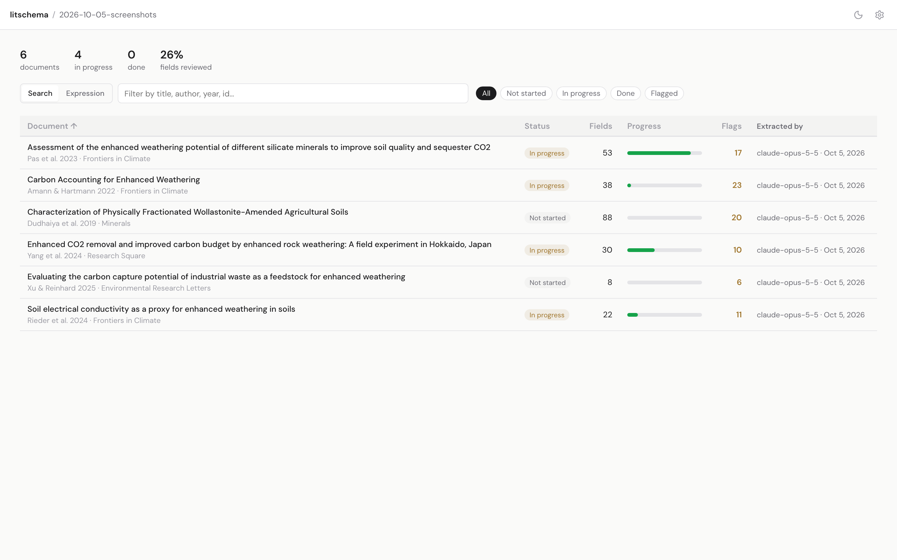
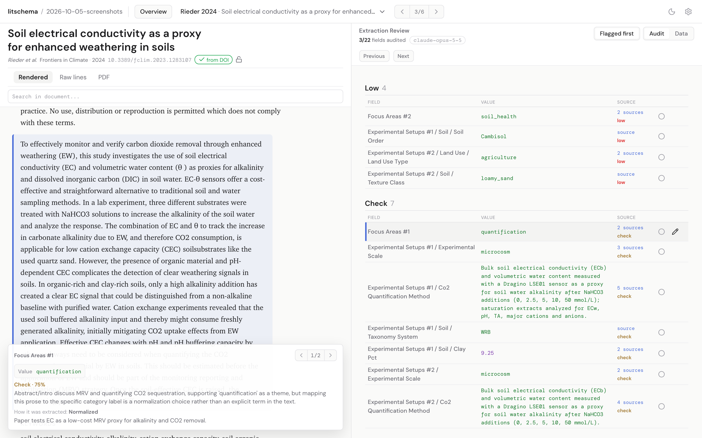
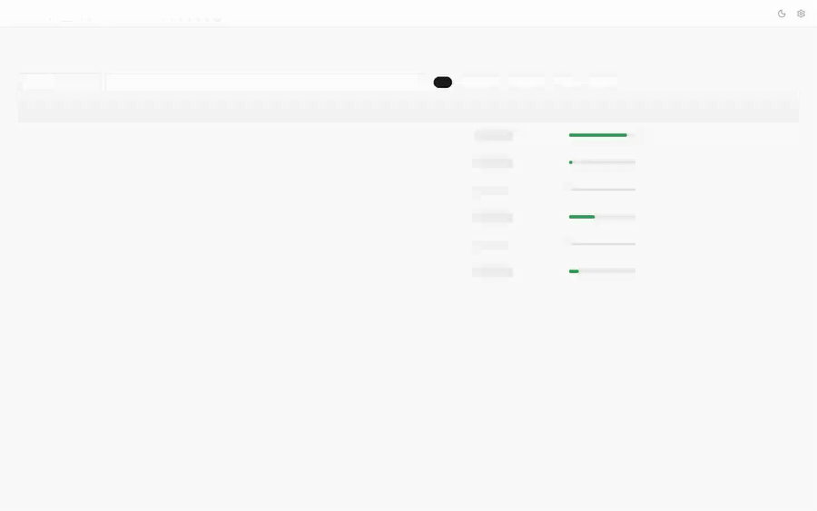

# Reviewing

```bash
litschema verify
```

The app runs on `127.0.0.1` only and loads nothing from the network.

## Overview

The overview lists every paper with its review progress, its flag count (check,
low, and can't-verify values from the latest grade), and its status. You can
filter by text or with an expression, and sort by any column. The filter and
sort stay in the URL.



## A paper

The left pane shows the paper's prepared text with its tables and figures. The
lines cited by the selected value are highlighted, and the PDF sits in a tab
beside the text. The right pane lists the extracted values in document order.
Each section collapses to a one-line summary of its review status, and a
section whose fields are all reviewed starts collapsed.



Select a value to see its evidence:

- **Extraction**: the value, the basis and the extractor's note.
- **Independent grader**: the grader's model, the band, the probability
  ("Medium · 72%"), and the issue, in its own block below.

Then **verify** the value, **correct** it with a typed editor, or **remove**
it. Free text edits in a box that grows with the value; Shift+Enter adds a
line break. Each action writes one entry to the run's `review.json`. Press
`Esc` to go back to the overview.


